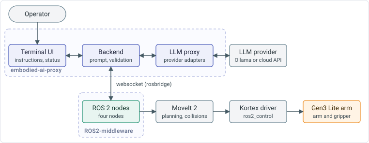

# Kinova Gen3 Lite ROS 2 Middleware


ROS 2 middleware that lets a language model control a Kinova Gen3 Lite robot arm. It runs a recipe, an ordered list of named actions in JSON, through MoveIt 2 and the Kinova driver stack. The proxy [`embodied-ai-proxy`](https://github.com/paul-isit/embodied-ai-proxy) turns an instruction in natural language into the recipe.

The system was developed for the Swinburne University Cyber Lab to study how language models respond to instructions for a robot arm, including malicious instructions.



<video src="https://github.com/user-attachments/assets/9ad3d129-2060-4627-a5c3-de03633666fe" autoplay loop muted playsinline></video>

## Quick start

The middleware needs Ubuntu 22.04, ROS 2 Humble and the Kinova packages. See [Installation](docs/installation/requirements.md).

```bash
cd ~/workspace/ros2_kortex_ws
colcon build --symlink-install
source install/setup.bash
ros2 launch kinova_interface robot.launch.py
```

The launch file starts the system in simulation and waits for a recipe. See the [Quickstart](docs/user-guide/quickstart.md) to run a recipe, use the real arm and send commands through the proxy.

## Documentation

The manual is published at [jeremy-allan.github.io/ROS2-middleware](https://jeremy-allan.github.io/ROS2-middleware/). Its sources are in `docs/`.

| Section | Pages |
|---|---|
| [Overview](docs/overview.md) | The parts of the system and the path of an instruction. |
| User guide | [Quickstart](docs/user-guide/quickstart.md), [Command reference](docs/user-guide/command-reference.md), [Recipes](docs/user-guide/recipes.md), [Troubleshooting](docs/user-guide/troubleshooting.md), [Demos](docs/user-guide/demos.md) |
| Installation | [Requirements](docs/installation/requirements.md), [Kinova drivers](docs/installation/kinova-drivers.md), [Middleware and proxy](docs/installation/middleware-and-proxy.md), [Configuration](docs/installation/configuration.md) |
| Technical | [Architecture](docs/technical/architecture.md), [ROS interfaces](docs/technical/ros-interfaces.md), [Safety and contracts](docs/technical/safety-and-contracts.md), [Testing](docs/technical/testing.md), [API reference](docs/technical/api/nodes.md) |
| Proxy | The [documentation of the proxy](https://github.com/paul-isit/embodied-ai-proxy/tree/main/docs) is published in the Proxy section of the manual. |

## Repository layout

```text
kinova_interface/     Nodes, actions, utilities, launch file, configuration, recipes, scripts and unit tests
kinova_interfaces/    Custom services and messages
computer_vision/      Optional Kinect v2 vision node (alpha release)
docs/                 Sources of the manual
mkdocs.yml            Configuration of the manual
```

## Contributing

See [CONTRIBUTING.md](CONTRIBUTING.md).

## License

Apache License 2.0. See [LICENSE](LICENSE).
