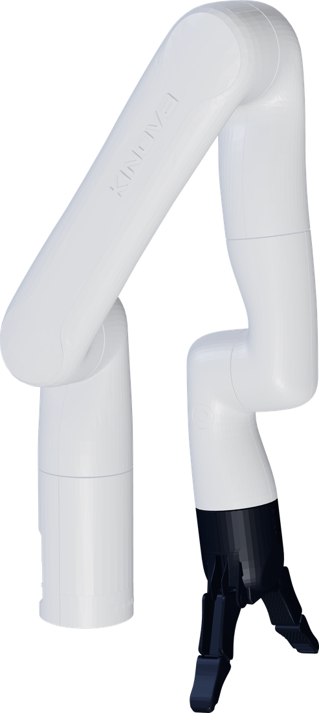
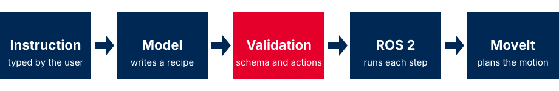

# LLM-controlled robot arm

Type an instruction in plain English. A language model turns it into a plan, the system validates it, and a Kinova Gen3 Lite arm carries it out. This manual covers setup, use and how it works.

[Quickstart](user-guide/quickstart.md){ .md-button .md-button--primary }
[Install](installation/middleware-and-proxy.md){ .md-button }
[How it works](overview.md){ .md-button }

## Start here

-   **User guide**

    Run the system and give it commands.

    [Quickstart](user-guide/quickstart.md) · [Troubleshooting](user-guide/troubleshooting.md) · [Demos](user-guide/demos.md)

-   **Installation**

    Set up ROS 2, the Kinova drivers, the middleware and the proxy.

    [Middleware and proxy](installation/middleware-and-proxy.md) · [Non-native Ubuntu](installation/non-native-ubuntu.md) · [Configuration](installation/configuration.md)

-   **Technical**

    How it works inside, and the code reference.

    [Architecture](technical/architecture.md) · [Safety and contracts](technical/safety-and-contracts.md) · [API reference](technical/api/nodes.md)

## How an instruction becomes motion

{ .flow }

## The ten actions

`home` `move` `relative move` `gripper` `pick up` `drop off` `pour` `push` `thrust` `throw`

The proxy rejects any recipe that uses another action.

Arm render from Kinova's open Kortex model (Apache-2.0).

