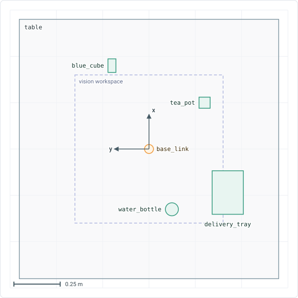

# Configuration

The middleware reads its configuration from YAML files in `kinova_interface/data/configs/` and from the arguments of `robot.launch.py`. This page lists each file, its settings and when a change takes effect.

## Files

| File | Contents | Read |
|---|---|---|
| `env/workspace_objects.yaml` | The objects and obstacles of the scene. | At start and on `/reset_environment`. |
| `env/movements_and_orientations.yaml` | The named relative moves and orientation presets. | At start. |
| `motion_settings.yaml` | The settings `hardware.*` of `kinova_hardware_client` and `grasping.*` of `pickup` and `dropoff`. | `hardware.*` at start. `grasping.*` at each pickup and dropoff. |
| `moveit/joint_limits.yaml` | The joint limits for MoveIt. See [Joint limits](../technical/kinova-drivers-and-apis.md#joint-limits). | At launch. |

Restart the launch to apply a change that is read at start. `colcon build` copies the files to the `install` folder. A build with `--symlink-install` links them to the source files, so a change to an existing file applies at the next launch. See [Middleware and proxy](middleware-and-proxy.md#install-the-middleware).

## Launch arguments

`robot.launch.py` takes these arguments:

| Argument | Default | Description |
|---|---|---|
| `recipe` | `none` | Recipe file that `json_parser_node` runs once, two seconds after start-up. A path relative to the installed `recipes` folder, or an absolute path. With `none`, the node waits for `/execute_recipe`. |
| `use_fake_hardware` | `true` | `true` simulates the arm. `false` connects to the arm at `robot_ip`. |
| `robot_ip` | `192.168.1.10` | IP address of the arm. With `use_fake_hardware:=false`, the argument must be given on the command line. |
| `bridge_port` | `9090` | Port of the rosbridge websocket that the proxy connects to. |
| `enable_CV` | `false` | Also launch the [computer vision](../technical/computer-vision.md) stack. |
| `debug_mode` | `false` | Debug-level logs for the four middleware nodes. |
| `core_debug` | `false` | Debug-level logs for all nodes, including `rcl` and the DDS layer. |
| `enable_individual_logs` | `false` | Also write a log file for each node. |

The output of the nodes appears in the terminal and in `launch.log` in the launch log folder, by default `~/.ros/log/<timestamp>-<host>-<pid>`. To use another folder, set `ROS_LOG_DIR` before the launch.

## Objects and obstacles

`env/workspace_objects.yaml` describes the scene in metres and radians, in the frame `base_link`.

- `objects` are the things that recipes can name. `move_arm`, `pickup`, `dropoff` and the other actions resolve their targets here. The proxy gives the names to the language model.
- `obstacles` are for collision checking only. MoveIt plans around them, but a recipe cannot name them. The obstacle `table` also gives the proxy the bounds of the table.

```yaml
objects:
  water_bottle:
    pose:
      position: {x: -0.3255, y: -0.1235, z: 0.065}
      orientation: {roll: 0.0, pitch: 0.0, yaw: 0.0}
    shape: {type: CYLINDER, dimensions: [0.22, 0.035]}
```

| Field | Description |
|---|---|
| `pose.position` | The centre of the shape. |
| `pose.orientation` | Required. Either `roll`, `pitch` and `yaw` in radians, or a quaternion `x`, `y`, `z`, `w`. A missing or incomplete orientation stops the node with a fatal error that names the entry. |
| `shape.type` | `BOX`, `CYLINDER`, `CONE` or `SPHERE`. An unknown type becomes `BOX` with a warning. `pickup` and `dropoff` work with `BOX` and `CYLINDER`. |
| `shape.dimensions` | `BOX`: `[x, y, z]`. `CYLINDER` and `CONE`: `[height, radius]`. `SPHERE`: `[radius]`. A list of the wrong length is replaced by a default with a warning. |

Names are case-sensitive. Keep the shape accurate, because grasps and placements are computed from it, not only from the position.

The default scene is:



| Name | Kind | Shape | Dimensions (m) | Position x, y, z (m) |
|---|---|---|---|---|
| `water_bottle` | Object | `CYLINDER` | 0.22 high, 0.035 radius | -0.3255, -0.1235, 0.065 |
| `tea_pot` | Object | `BOX` | 0.06 by 0.06 by 0.075 | 0.25, -0.30, -0.0125 |
| `blue_cube` | Object | `BOX` | 0.107 by 0.043 by 0.073, turned 1.57 rad about y | 0.45, 0.2, 0.0035 |
| `delivery_tray` | Object | `BOX` | 0.235 by 0.168 by 0.025 | -0.235, -0.425, -0.028 |
| `table` | Obstacle | `BOX` | 1.4 by 1.4 by 0.05 | 0, 0, -0.075 |
| `small_wall` | Obstacle | `BOX` | 0.03 by 0.3 by 0.2 | -100.1665, -0.0855, 0.052 |

The position of `small_wall` is 100 m from the arm, so the wall does not affect any plan.

The `computer_vision` node adds the objects that it detects to the scene. Do not copy them into the file. `/reset_environment` removes them and restores the objects of the file.

## Movements and orientations

`env/movements_and_orientations.yaml` gives names to values, so that a recipe, and the language model behind it, refers to a name and not to numbers.

The `relative_movements` are offsets in metres in `base_link`. A `relative_move` step adds an offset to the current position of `tool_frame`. Forward is +x, left is +y and up is +z.

| Name | x | y | z |
|---|---|---|---|
| `move_upwards` | 0.0 | 0.0 | 0.1 |
| `move_downwards` | 0.0 | 0.0 | -0.1 |
| `move_left` | 0.0 | 0.1 | 0.0 |
| `move_right` | 0.0 | -0.1 | 0.0 |
| `thrust_forward` | 0.1 | 0.0 | 0.0 |
| `retreat` | -0.1 | 0.0 | 0.0 |

The `orientations` are values of roll, pitch and yaw in radians for `tool_frame` in `base_link`. A `move_arm` step uses one as the `orientation`.

| Name | Roll | Pitch | Yaw | Gripper points | Fingers close along |
|---|---|---|---|---|---|
| `top_down` | 3.141593 | 0.0 | 1.570796 | Straight down. | y of `base_link` |
| `top_down_90` | 3.141593 | 0.0 | 0.0 | Straight down. | x of `base_link` |
| `side_level` | 1.570796 | 0.0 | 1.570796 | Forward, level. | y of `base_link` |

The fingers point along +z of `tool_frame` and close along its x axis. The unit test `test_orientation_presets_match_their_axes` fails when a preset does not match its name. A new preset needs its axes in that test.

## Motion settings

`motion_settings.yaml` holds ROS parameters that the launch file passes to `kinova_hardware_client` and `json_parser_node`. Every setting is required, and a missing one stops the node at start. Write decimals with a decimal point, for example `30.0`, because a whole number is rejected.

### hardware

`kinova_hardware_client` reads these settings at start. They apply to `home`, `move_arm`, `relative_move`, `joint_move`, the gripper and the execution of planned trajectories. `json_parser_node` reads the two timeouts as well. It waits `2 × hardware.action_timeout + 5` s for an arm move and `hardware.gripper_timeout + 5` s for a gripper move, which is longer than the client does.

| Setting | Default | Description |
|---|---|---|
| `hardware.action_timeout` | `30.0` | Time that an arm move may take before it counts as failed, in seconds. |
| `hardware.gripper_timeout` | `10.0` | The same for a gripper move, in seconds. |
| `hardware.planning_time` | `10.0` | Time that MoveIt may plan one move, in seconds. |
| `hardware.goal_tolerance` | `0.01` | Radius of the position goal of `move_arm` and `relative_move`, in metres. |
| `hardware.home_joint_positions` | `[0.0, 0.0, 1.5708, 1.5708, 1.5708, 0.0]` | Joint angles of the `home` pose for `joint_1` to `joint_6`, in radians. |
| `hardware.home_joint_tolerance` | `0.01` | Tolerance of each joint at the home pose, in radians. |

### grasping

`json_parser_node` reads these settings for `pickup` and `dropoff` each time one runs. Change one while the node runs with `ros2 param set /json_parser_node grasping.<name> <value>`. It applies from the next `pickup` or `dropoff`. See [Pickup and dropoff](../technical/motion-and-actions/pickup-and-dropoff.md) for how they are used.

| Setting | Default | Description |
|---|---|---|
| `grasping.velocity_scale` | `0.5` | Velocity of the moves as a fraction of the maximum, above 0 and up to 1. |
| `grasping.acceleration_scale` | `0.8` | Acceleration of the moves as a fraction of the maximum, above 0 and up to 1. |
| `grasping.fallback_planning_time` | `5.0` | Planning time of OMPL RRT\* for a waypoint that Pilz cannot plan, in seconds. RRT\* uses all of it. |
| `grasping.upright_tolerance` | `0.2` | Tilt that a held object may have while it is carried upright, in radians. Turning about the vertical axis is free. |
| `grasping.position_tolerance` | `0.001` | Radius of the position goal of RRT\*, in metres. Pilz is exact. |
| `grasping.orientation_tolerance` | `0.001` | Tolerance of the orientation goal of RRT\* for each axis, in radians. |
| `grasping.cartesian_step` | `0.0025` | Distance between the points of a straight line planned with MoveIt's Cartesian path, in metres. |
| `grasping.max_joint_jump` | `0.5` | Largest change of a joint between two points of that path, in radians. A larger change means that the wrist would flip. |
| `grasping.yaw_step_deg` | `30.0` | Angle between the grasps and placements that are tried around an object, in degrees. |
| `grasping.standoff` | `0.08` | Distance in metres at which the gripper lines up before the approach, and to which it backs away after the release. |
| `grasping.lift_height` | `0.10` | Height of the lift after a grasp, in metres. |
| `grasping.top_grasp_depth` | `0.02` | Depth of the finger pads below the top of the object in a top grasp, in metres. |
| `grasping.tip_clearance` | `0.01` | Distance that the fingertips keep above the bottom of the object in a top grasp, in metres. |
| `grasping.tall_ratio` | `2.0` | An object taller than this many times its narrowest horizontal width gets a side grasp from `auto`. |
| `grasping.width_margin` | `0.015` | Grasps are skipped when the object is wider than the opening of the gripper minus this margin, in metres. |
| `grasping.min_width` | `0.01` | Grasps are skipped when the object is narrower than this, in metres. |
| `grasping.place_clearance` | `0.02` | Height above the surface at which `dropoff` releases the object, in metres. |
| `grasping.default_place_offset` | `0.05` | Hover height of `dropoff` above the release pose when the step has no `place_offset`, in metres. |
| `grasping.max_place_offset` | `0.12` | Largest `place_offset` that a step may use, in metres. |

## Proxy

The proxy has its own configuration: the language model provider, the system prompt and the recipe schema. See the [proxy README](https://github.com/paul-isit/embodied-ai-proxy#configuring-the-llm). If `bridge_port` is changed, set the same port in the `rosbridge_url` of the proxy.
