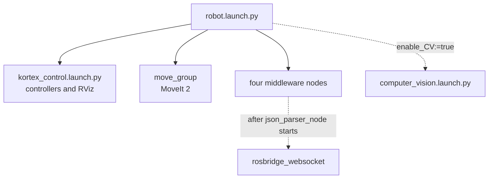
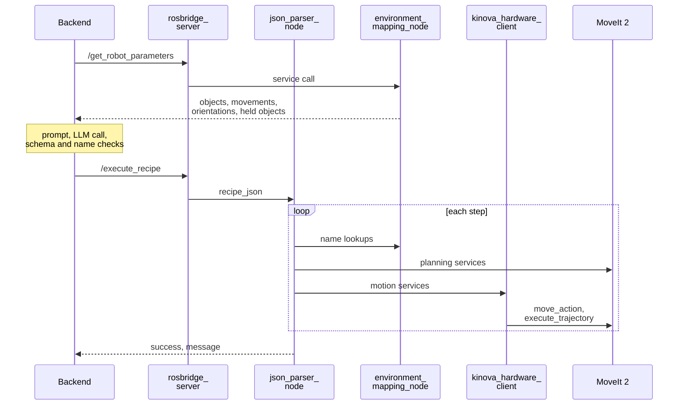

# Architecture

The repository contains three ROS 2 packages, including the optional `computer_vision` package. `robot.launch.py` starts the Kinova driver stack, MoveIt 2 and four middleware nodes. When enabled, `vision_snapshot_node` adds detected objects to the scene.

## Packages

Each package is a folder of the same name at the root of the repository.

| Package | Contents |
|---|---|
| `kinova_interface` | The four nodes, the ten actions, `robot.launch.py`, configuration, recipes, scripts and unit tests. |
| `kinova_interfaces` | Custom services and messages. See [ROS interfaces](ros-interfaces.md). |
| `computer_vision` | `vision_snapshot_node`, its launch file and configuration. See [Computer vision](computer-vision.md). |

## Start-up

`robot.launch.py` starts the following components:



`kortex_control.launch.py` belongs to the Kinova `ros2_kortex` packages. It starts `ros2_control_node`, `robot_state_publisher`, the `joint_state_broadcaster`, the `joint_trajectory_controller`, the `twist_controller` (inactive), the `gen3_lite_2f_gripper_controller` and RViz. With `use_fake_hardware:=false` the Kortex driver connects to the arm at `robot_ip` and the `fault_controller` is started. With `true` the hardware is simulated. See [Kinova drivers and APIs](kinova-drivers-and-apis.md).

The four nodes take their configuration from `motion_settings.yaml` and the `env/` folder. See [Configuration](../installation/configuration.md).

## Request flow

The sequence below shows one instruction from the terminal UI to the arm.



## Nodes

| Node | Role |
|---|---|
| `json_parser_node` | Receives recipes, runs the actions in order and reports the result. |
| `environment_mapping_node` | Holds the object dictionary and the named movements and orientations. Keeps MoveIt's planning scene in step. |
| `kinova_hardware_client` | The only node that sends motion commands to the arm and gripper. Its executable is `hardware_interface_client`. |
| `telemetry_node` | Combines node heartbeats into one system status. Hosts the fault reset service. |

Each node is described in [Middleware nodes](middleware-nodes.md).

## Communication

- Recipes arrive on `/execute_recipe`, a ROS 2 service. A second service, `/reset_environment`, resets the scene.
- Actions look names up through services on `environment_mapping_node`. They plan through MoveIt services and run motions through services on `kinova_hardware_client`.
- `kinova_hardware_client` talks to MoveIt and the gripper controller through ROS 2 actions.
- `json_parser_node`, `environment_mapping_node` and `kinova_hardware_client` each publish a heartbeat on `/status/node_report` every 0.5 s. `telemetry_node` publishes the aggregate on `/system/status`.
- The proxy never calls a ROS 2 service directly. It connects to `rosbridge_server`, which translates websocket messages into service calls and topic messages.

## Execution model

- `json_parser_node` runs one recipe at a time. `/execute_recipe` and `/reset_environment` share a mutually exclusive callback group, so a reset cannot run while a recipe is running.
- Steps run in order. The first failed step stops the recipe.
- Each node runs a multi-threaded executor: 10 threads for `json_parser_node`, `kinova_hardware_client` and `telemetry_node`, 4 for `environment_mapping_node`.

## Frames and units

| Item | Value |
|---|---|
| Base frame | `base_link` |
| Tool frame | `tool_frame`, at the centre of the finger pads. The fingers point along +Z and close along X. |
| Length | metres |
| Angle | radians |
| Time | seconds |

In `base_link`, +X points out of the front of the robot, +Y to its left and +Z up.

## Repository layout

```text
ROS2-middleware/
  kinova_interface/
    data/configs/            motion_settings.yaml, env/, moveit/joint_limits.yaml
    kinova_interface/        nodes/, actions/, utils/
    launch/                  robot.launch.py
    recipes/                 task_recipe.json, test_suite/
    scripts/                 run_recipe.py, check_orientations.py
    test/                    unit tests
  kinova_interfaces/         srv/, msg/
  computer_vision/           vision node, launch file, config/
  docs/                      this manual
```

The workspace used in this manual places the middleware beside the Kinova packages. The proxy is a separate project.

```text
~/workspace/
  ros2_kortex_ws/
    src/
      ros2_kortex/           Kinova driver, description and MoveIt configuration
      ROS2-middleware/       this repository
  embodied-ai-proxy/
```
