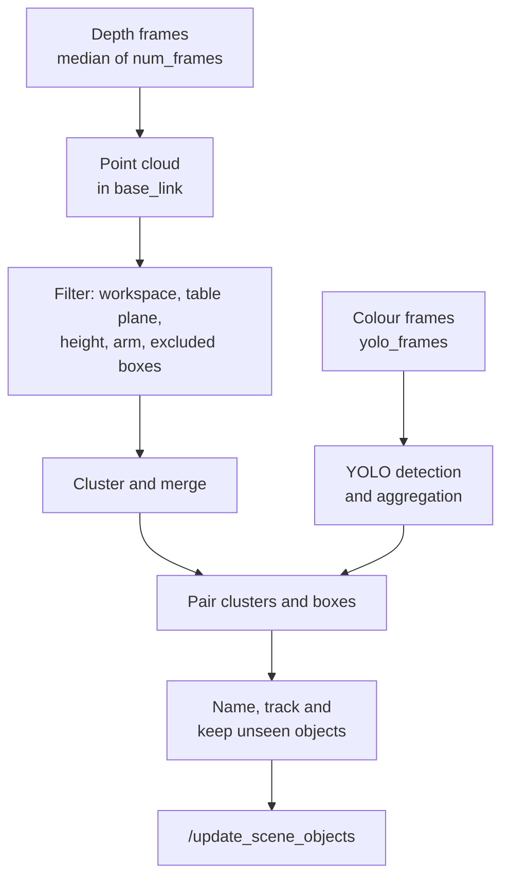

# Computer vision

`computer_vision` is an optional package. Its node, `vision_snapshot_node`, finds the objects on the table with a Kinect v2 and adds them to the scene of `environment_mapping_node`, so that recipes can name them. The node works on request. It takes one snapshot for each call of `/vision/snapshot`.

!!! note "Alpha release"
    Computer vision is an alpha release. Its behaviour and parameters can change, and detected objects can be missing, mislabelled or approximated by boxes. Check the result with `/vision/debug_image` or `/get_scene_objects` before running a recipe that uses it. The rest of the middleware does not depend on it. Without `enable_CV:=true`, the objects come from `workspace_objects.yaml`.

## Snapshot pipeline

A snapshot turns depth and colour frames into named objects in the scene.



## Start-up

`robot.launch.py` includes `computer_vision.launch.py` when `enable_CV:=true`:

```bash
ros2 launch kinova_interface robot.launch.py enable_CV:=true
```

`computer_vision.launch.py` starts these processes.

| Process | Package | Start | Condition |
|---|---|---|---|
| `kinect2_bridge_node` | `kinect2_bridge` | At launch. | Always. |
| `vision_snapshot_node` | `computer_vision` | 5 s after launch. | Always. |
| Saved calibration (`publish.launch.py`) | `easy_handeye2` | At launch. | `extrinsic_calibrate:=false` and `use_static_transform:=false`. |
| `kinect_static_tf` | `tf2_ros` | 1.5 s after `vision_snapshot_node` logs `ready`. | `extrinsic_calibrate:=false` and `use_static_transform:=true`. |
| `aruco_tracker` | `aruco_opencv` | 7 s after launch. | `extrinsic_calibrate:=true`. |
| Calibration GUI (`calibrate.launch.py`) | `easy_handeye2` | 10 s after launch. | `extrinsic_calibrate:=true`. |

`robot.launch.py` starts the file with the default arguments. To set an argument, start `robot.launch.py` without `enable_CV` and run `ros2 launch computer_vision computer_vision.launch.py <argument>:=<value>` in a second terminal. The arguments are `extrinsic_calibrate` and `use_static_transform`, both `false` by default, and every setting of [`calibration.yaml`](#calibration). See [Camera and calibration](../installation/camera-and-calibration.md) for the procedure.

## Snapshot service

`/vision/snapshot` has the type `kinova_interfaces/srv/Snapshot`.

| Field | Type | Description |
|---|---|---|
| `num_frames` | uint32 | Number of depth frames. `0` uses the `num_frames` parameter. |
| `remove_missing` | bool | Remove vision objects that are no longer seen, after the grace period. |
| `success` | bool | `true` when `/update_scene_objects` accepted the objects. |
| `message` | string | The message of `/update_scene_objects`, for example `Scene updated: 2 added, 1 updated, 0 removed, 5 total`. A failure gives `Snapshot failed: <reason>`, `/update_scene_objects not available` or `timed out`. |
| `summary_json` | string | Per object `label`, `source` and `conf`, the list `unidentified`, the list `dropped` (YOLO detections without a cluster) and the list `notes` (objects kept or removed). `{}` when the snapshot failed. |

The node waits up to 10 s plus 0.3 s per frame for the depth frames. The `/scan` command of the terminal UI calls this service with `num_frames` 0 and `remove_missing` `true`, and reports the objects that were added and removed.

## Pipeline steps

1. **Capture.** The node takes the median of the depth frames for each pixel. A pixel that is valid in fewer than half of the frames is discarded. It runs YOLO on `yolo_frames` colour frames, taken from the HD topic when `hd_color_topic` is set.
2. **Point cloud.** Depth values between 0.3 m and 4.5 m become points in `base_frame`, through the camera intrinsics and the TF transform of the camera frame.
3. **Filter.** Points outside the `workspace` are removed. The node fits a plane to the points within `plane_band` of `table_z`. It needs 500 points; without them it uses the constant `table_z`. It then removes points less than `min_height` or more than `max_height` above the plane, points within `arm_radius` of an arm frame and points inside an `exclude_boxes` box. The node logs a warning when the plane tilts by more than 1°, as a likely calibration error.
4. **Denoise.** Points whose mean distance to their 10 nearest neighbours is in the largest 10 % are removed.
5. **Cluster.** DBSCAN with the distance `cluster_eps` and a minimum of 10 points forms clusters. A cluster needs `cluster_min_points` points. Clusters closer than `merge_gap` are merged. Clusters that touch the border of the workspace are dropped when `drop_border_clusters` is `true`. Each cluster becomes a box: its footprint is the minimum-area rectangle of the points, after a trim of 2 % at each end of x and y, and its height is the 95th percentile of the point heights above the plane.
6. **Detect.** Detections of the colour frames are tracked by IoU (`yolo_track_iou`). A track that appears in fewer than `yolo_min_presence` of the frames is discarded. The label with the largest summed confidence wins. Boxes of the HD image are mapped to the depth image through the table plane.
7. **Pair.** When `split_by_boxes` is `true`, a cluster that two or more boxes claim is split by box. A box claims a cluster when `claim_frac` of the cluster pixels are inside it. The node pairs clusters and boxes with the Hungarian algorithm. The score of a pair is 0.5 × IoU + 0.5 × the share of cluster pixels inside the box. A pair needs a score of at least `match_thresh`. A paired cluster takes the label of its box. An unpaired cluster becomes an unidentified `object`. A box without a cluster is dropped.
8. **Name and track.** See [Scene objects](#scene-objects).
9. **Push.** The node adds `table_fit` and sends the objects to `/update_scene_objects`.

## Scene objects

Every object is a box. Its fields are:

| Field | Value |
|---|---|
| Name | `<color>_<label>`, for example `red_cup`. A counter follows when the name is taken, for example `red_cup_1`. Unidentified objects are `<color>_object`. |
| `label` | The YOLO class name in lower case with underscores, or `object`. |
| `label_source` | `yolo`: the label of a paired box. `carried`: the label of the previous snapshot. `fallback`: no box, label `object`. |
| `confidence` | The aggregated YOLO confidence. `fallback` objects have 0.3. |
| `color` | The most frequent colour name among the pixels of the object: `red`, `orange`, `yellow`, `green`, `blue`, `purple`, `white`, `gray` or `black`. |
| `shape` | `BOX` with the footprint and height of the cluster. Unidentified objects are larger by `unknown_margin` on each side and on top. |
| `pose` | The centre of the box, turned about the vertical axis only. The bottom of the box is `table_clearance` above the top of `table_fit`. |

Objects keep their name between snapshots:

- An object keeps the name of an object with the same label that was within `id_match_dist` in the previous snapshot.
- A new label does not replace the previous one when its source is `fallback` or its confidence is below `label_flip_conf`. The object keeps the previous label as `carried`, with 0.8 times the previous confidence, until that falls below `carried_conf_floor`.
- With `remove_missing`, an object that is not seen stays in the scene for `grace_snapshots` snapshots, for example while the arm hides it. After that, `/update_scene_objects` removes it. Objects held by the gripper and objects from `workspace_objects.yaml` are not removed.

`table_fit` is a box, 0.05 m thick, that spans the workspace. Its top is the highest point of the fitted plane over the workspace. The node adds it when the plane fit succeeds.

## Limits

- Objects are boxes, and a round object is represented by the box around it.
- Objects are turned about the vertical axis only.
- A YOLO detection without depth points under it is dropped, for example a transparent object.
- The default model, `yolov8n.pt`, detects the 80 COCO classes. Other objects are unidentified.

## Topics

| Topic | Type | Description |
|---|---|---|
| `/vision/debug_image` | `sensor_msgs/Image` | Published at each snapshot. The colour image with the points that passed the filters tinted yellow, YOLO boxes in orange, and one box for each object with its name and confidence: green for `yolo`, yellow for `carried`, red for `fallback`. |
| `/vision/workspace` | `visualization_msgs/MarkerArray` | Published at 1 Hz. The edges of the workspace, from the table plane up to `max_height`. |

To display them in RViz, add an `Image` display for `/vision/debug_image` and a `MarkerArray` display for `/vision/workspace`.

## Parameters

The launch file loads `camera.yaml`, `vision.yaml` and `yolo.yaml` from the `config` folder of the package. Write floating-point values with a decimal point, for example `0.0` and not `0`. Change a value at run time with `ros2 param set /vision_snapshot_node <name> <value>`. It applies from the next snapshot, except for `base_frame`, the topics, `yolo_model` and `ignore_labels`, which the node reads at start.

### camera.yaml

| Parameter | Default | Description |
|---|---|---|
| `base_frame` | `base_link` | Frame of the workspace, the table plane and the object poses. |
| `color_topic` | `/kinect2/sd/image_color_rect` | Colour image at the resolution of the depth image. |
| `depth_topic` | `/kinect2/sd/image_depth_rect` | Depth image. `16UC1` and `mono16` values are in millimetres. |
| `info_topic` | `/kinect2/sd/camera_info` | Camera intrinsics. Its `frame_id` is the camera frame. |
| `hd_color_topic` | `/kinect2/hd/image_color_rect` | HD colour image for YOLO. An empty string uses the colour image of `color_topic`. |
| `hd_info_topic` | `/kinect2/hd/camera_info` | Camera intrinsics of the HD image. |
| `arm_frames` | `shoulder_link`, `arm_link`, `forearm_link`, `lower_wrist_link`, `upper_wrist_link`, `end_effector_link` | Frames of the arm. A sphere around each frame is removed from the point cloud. A frame that is not in TF is skipped with a warning. |
| `arm_radius` | `0.12` | Radius of those spheres in metres. |
| `exclude_boxes` | `[-0.09, 0.05, -0.06, 0.06, -0.20, 0.06]` | Boxes in `base_frame` that are removed from the point cloud, each as `x_min`, `x_max`, `y_min`, `y_max`, `z_min`, `z_max` in metres. Several boxes are consecutive groups of six values. The default box covers the mount of the arm. |

### vision.yaml

| Parameter | Default | Description |
|---|---|---|
| `workspace` | `[-0.40, 0.40, -0.40, 0.40]` | The region of the table that the node uses: `x_min`, `x_max`, `y_min`, `y_max` in `base_frame`, in metres. |
| `table_z` | `0.008` | Expected height of the table surface in metres. The plane fit starts here, and the node uses it when the fit fails. The node logs a warning when the fitted height differs by more than half of `plane_band`. |
| `plane_band` | `0.08` | Points within this height of `table_z` are used for the plane fit, in metres. |
| `min_height` | `0.006` | Points lower than this above the plane are ignored, in metres. Lower it for thin objects. Raise it when the table appears as an object. |
| `max_height` | `0.30` | Points higher than this above the plane are ignored, in metres. |
| `cluster_eps` | `0.018` | Maximum distance between points of one cluster, in metres. |
| `cluster_min_points` | `200` | Minimum number of points of a cluster. |
| `merge_gap` | `0.02` | Clusters closer than this are merged, in metres. Depth dropouts can split one object. `0.0` turns merging off. |
| `drop_border_clusters` | `true` | Drop clusters that touch the edge of the workspace. Widen `workspace` when such an object is real. |
| `num_frames` | `8` | Depth frames per snapshot when the request has `num_frames` 0. More frames are more stable and slower. |
| `save_dir` | `''` | A folder that receives `<unix time>.npz` for every snapshot, with `color`, `depth`, `K` and `T`. An empty string turns recording off. |
| `unknown_margin` | `0.005` | Margin added to unidentified objects, in metres. |
| `table_clearance` | `0.01` | Gap between the top of `table_fit` and the bottom of every object, in metres. |
| `id_match_dist` | `0.08` | Largest distance for two detections to count as the same object, in metres. |
| `label_flip_conf` | `0.6` | A new label below this confidence does not replace the previous label. |
| `grace_snapshots` | `2` | Snapshots for which an unseen object stays in the scene. |

### yolo.yaml

| Parameter | Default | Description |
|---|---|---|
| `yolo_model` | `yolov8n.pt` | Ultralytics YOLO model file. An empty string turns detection off, and every object is unidentified. |
| `yolo_device` | `''` | `cpu`, `cuda:0` or an empty string for automatic selection. |
| `yolo_imgsz` | `640` | Image size for inference, in pixels. Raise it when small objects are missed. |
| `yolo_conf` | `0.25` | Confidence threshold of a single frame. Keep it low, because the aggregation over frames filters the detections. |
| `yolo_frames` | `5` | Colour frames per snapshot. |
| `yolo_min_presence` | `0.4` | Fraction of the frames in which a detection must appear. |
| `yolo_track_iou` | `0.5` | Minimum IoU for detections of different frames to count as one object. |
| `carried_conf_floor` | `0.4` | A carried label is dropped when its confidence falls below this value. |
| `match_thresh` | `0.30` | Minimum score to pair a cluster with a box. |
| `claim_frac` | `0.25` | Fraction of the cluster pixels that must be inside a box for the box to claim the cluster. |
| `split_by_boxes` | `true` | Split clusters that two or more boxes claim, so that touching objects become separate objects. |
| `ignore_labels` | `"table, chair"` | Class names that are discarded, separated by commas, in lower case with underscores. |

## Calibration

The node needs the TF transform from `base_frame` to the camera frame. `kinect2_bridge` publishes the camera frames below `kinect2_link`. The calibration provides the transform from `base_link` to `kinect2_link`, either as the saved `easy_handeye2` calibration called `calibration_name`, or as the static transform of `calibration.yaml` when `use_static_transform` is `true`. With `extrinsic_calibrate:=true`, the launch file runs the calibration procedure instead.

`calibration.yaml` has these settings. Each is also a launch argument of the same name.

| Setting | Default | Description |
|---|---|---|
| `calibration_name` | `kinect_eye_on_base` | Name under which `easy_handeye2` stores and loads the calibration. |
| `robot_base_frame` | `base_link` | Base frame of the arm. |
| `robot_effector_frame` | `tool_frame` | End-effector frame that carries the marker. |
| `tracking_base_frame` | `kinect2_link` | Base frame of the camera. |
| `tracking_marker_frame` | `marker_0` | Frame of the ArUco marker. |
| `cam_base_topic` | `/kinect2/hd/image_color_rect` | Image topic for the marker detection. |
| `marker_dict` | `6X6_250` | ArUco dictionary of the marker. |
| `marker_size` | `0.095` | Edge length of the marker, in metres. |
| `static_tf_parent_frame` | `base_link` | Parent frame of the static transform. |
| `static_tf_child_frame` | `kinect2_link` | Child frame of the static transform. |
| `static_tf_x`, `static_tf_y`, `static_tf_z` | `0.0`, `1.0`, `0.53` | Position of the camera in metres. |
| `static_tf_roll`, `static_tf_pitch`, `static_tf_yaw` | `0.925`, `3.1`, `-0.05` | Orientation of the camera in radians. |
