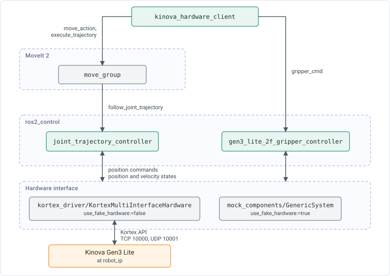

# Kinova drivers and APIs

The middleware uses Kinova ROS 2 packages, ros2_control and MoveIt 2 for arm control. This page documents their roles, launch configuration and motion error messages.

## Control path

A motion command reaches the arm through the components in the figure.

`kinova_hardware_client` sends planning and execution goals to `move_group` and gripper goals to the gripper controller. `move_group` runs the planned trajectory on `joint_trajectory_controller`. The controllers exchange commands and states with the hardware interface. `joint_state_broadcaster` publishes the states on `/joint_states`.

## Kinova packages

The middleware is built against the `humble` branch of [ros2_kortex](https://github.com/Kinovarobotics/ros2_kortex). See [Kinova drivers](../installation/kinova-drivers.md) for the installation.

| Package | Contents |
|---|---|
| `kortex_api` | The Kortex API library. |
| `kortex_driver` | The `ros2_control` hardware interface for the arm, `kortex_driver/KortexMultiInterfaceHardware`. |
| `kortex_description` | The robot description, meshes and controller configuration for the Gen3 and Gen3 Lite. |
| `kortex_bringup` | Launch files. `kortex_control.launch.py` starts the controller manager, the controllers, `robot_state_publisher` and RViz. |
| `kinova_gen3_lite_moveit_config` | The MoveIt configuration for the Gen3 Lite with the two-finger gripper. |

## Hardware modes

`use_fake_hardware` selects the `ros2_control` hardware interface.

| Value | Hardware interface | Behaviour |
|---|---|---|
| `true` | `mock_components/GenericSystem` | The joint states follow the commands. No arm is needed. The fault controller is not started. This is the default of `robot.launch.py`. |
| `false` | `kortex_driver/KortexMultiInterfaceHardware` | The driver connects to the arm at `robot_ip`. The fault controller is started. |

`robot.launch.py` stops with an error when `use_fake_hardware` is `false` and `robot_ip` is not given on the command line.

## Launch arguments

`robot.launch.py` includes `kortex_control.launch.py` with these arguments.

| Argument | Value |
|---|---|
| `robot_ip` | The launch argument `robot_ip`. Default value is `192.168.1.10`. |
| `use_fake_hardware` | The launch argument `use_fake_hardware`. |
| `robot_type` | `gen3_lite` |
| `dof` | `6` |
| `gripper` | `gen3_lite_2f` |
| `gripper_joint_name` | `right_finger_bottom_joint` |
| `controllers_file` | `ros2_controllers.yaml` |
| `robot_hand_controller` | `gen3_lite_2f_gripper_controller` |

The other arguments of `kortex_control.launch.py` keep their defaults. These apply to the connection to the arm:

| Argument | Default | Description |
|---|---|---|
| `username` | `admin` | Session username. |
| `password` | `admin` | Session password. |
| `port` | `10000` | TCP port of the arm. |
| `port_realtime` | `10001` | UDP port for real-time control. |
| `session_inactivity_timeout_ms` | `60000` | Session inactivity timeout. |
| `connection_inactivity_timeout_ms` | `2000` | Connection inactivity timeout. |
| `use_internal_bus_gripper_comm` | `true` | Communicates with the gripper over the internal bus of the arm. The launch file sets it to `false` when `use_fake_hardware` is `true`. |
| `launch_rviz` | `true` | Starts RViz with `view_robot.rviz`, which shows a grid and the robot model. |

## Controllers

The controller manager runs at 1000 Hz. The configuration is `arms/gen3_lite/6dof/config/ros2_controllers.yaml` in `kortex_description`.

| Controller | Type | Role |
|---|---|---|
| `joint_state_broadcaster` | `joint_state_broadcaster/JointStateBroadcaster` | Publishes `/joint_states`. |
| `joint_trajectory_controller` | `joint_trajectory_controller/JointTrajectoryController` | Runs trajectories on `joint_1` to `joint_6` through the `follow_joint_trajectory` action. |
| `gen3_lite_2f_gripper_controller` | `position_controllers/GripperActionController` | Moves `right_finger_bottom_joint` through the `gripper_cmd` action. `allow_stalling` is `true`. |
| `fault_controller` | `picknik_reset_fault_controller/PicknikResetFaultController` | Publishes `/fault_controller/is_faulted` and serves `/fault_controller/reset_fault`. Started on real hardware only. |
| `twist_controller` | `picknik_twist_controller/PicknikTwistController` | Started inactive. The middleware does not use it. |

MoveIt sends trajectories to `joint_trajectory_controller` and gripper goals to `gen3_lite_2f_gripper_controller`, as set in `moveit_controllers.yaml`.

## Gripper

The gripper is one commanded joint, `right_finger_bottom_joint`. The other finger joints follow it. The range of the joint in the robot description is 0.0 rad to 0.85 rad. The middleware uses 0.0 for open and 0.8 for closed. Closing on an object stops when the fingers meet it, because `allow_stalling` is `true`, and the step counts as successful.

## Joint limits

| Joint | Position (rad) | Velocity (rad/s) |
|---|---|---|
| `joint_1` | -2.68 to 2.68 | 1.6 |
| `joint_2` | -2.61 to 2.61 | 1.6 |
| `joint_3` | -2.61 to 2.61 | 1.6 |
| `joint_4` | -2.6 to 2.6 | 1.6 |
| `joint_5` | -2.53 to 2.53 | 1.6 |
| `joint_6` | -2.6 to 2.6 | 3.2 |
| `right_finger_bottom_joint` | 0.0 to 0.85 | 0.6 |

The position limits come from `kortex_description`. `robot.launch.py` loads the velocity limits from `kinova_interface/data/configs/moveit/joint_limits.yaml`. That file is the Kinova `joint_limits.yaml` with acceleration limits turned on, because the Pilz planner needs them. Every joint has an acceleration limit of 1.0 rad/s².

## MoveIt configuration

- The planning group `arm` contains the six arm joints and `tool_frame`. The group `gripper` contains the finger joints.
- The kinematics solver is `kdl_kinematics_plugin/KDLKinematicsPlugin`.
- The middleware plans with the `pilz_industrial_motion_planner` and `ompl` pipelines. See [Motion and actions](motion-and-actions/index.md).
- The Cartesian limits of the Pilz planner are 1.0 m/s, 2.25 m/s² acceleration, -5.0 m/s² deceleration and 1.57 rad/s rotation.
- `move_group` is started with `MoveItConfigsBuilder` for the robot `gen3_lite_gen3_lite_2f`.

## Errors when a move fails

A failed move reports the MoveIt error code as text. The same text appears in the step message, for example `Failed to move to 'blue_cube': planning failed (path blocked by an obstacle or self-collision)`.

| Code | Message | Cause and check |
|---|---|---|
| -1 | `planning failed (path blocked by an obstacle or self-collision)` | No collision-free path was found within `hardware.planning_time`. Check the objects and obstacles in the scene. |
| -31 | `out of reach (no IK solution)` | No joint configuration reaches the pose. Check that the target is inside the workspace and that the orientation is possible. |
| -12 | `goal in collision (target inside an obstacle)` | The target overlaps an object, an obstacle or the table. |
| -10 | `start state in collision (robot is currently in collision)` | The arm is in contact with the scene, for example a held object that touches the table. |
| -2 | `invalid motion plan` | MoveIt rejected the planned trajectory before it ran. |
| -3 | `motion plan invalidated by an environment change` | The scene changed while the plan was running. |
| -4 | `control failed during execution (hardware error)` | The controller reported a failure. See [Fault handling](safety-and-contracts.md#fault-handling). |
| -6 | `timed out` | Planning or execution exceeded its time limit. |
| -21 | `frame transform failed` | A transform is missing. Check that `robot_state_publisher` is running. |
| -23 | `robot state stale` | MoveIt has no recent joint states. Check `/joint_states`. |
| 99999 | `MoveIt failed` | MoveIt reported a general failure. |

The other codes use the MoveIt name in lower case.

| Code | Message |
|---|---|
| -5 | `unable to acquire sensor data` |
| -7 | `preempted` |
| -11 | `start state violates path constraints` |
| -13 | `goal violates path constraints` |
| -14 | `goal constraints violated` |
| -15 | `invalid group name` |
| -16 | `invalid goal constraints` |
| -17 | `invalid robot state` |
| -18 | `invalid link name` |
| -19 | `invalid object name` |
| -22 | `collision checking unavailable` |
| -24 | `sensor info stale` |
| -25 | `communication failure` |
| -26 | `start state invalid` |
| -27 | `goal state invalid` |
| -28 | `unrecognized goal type` |
| -29 | `MoveIt crashed` |
| -30 | `aborted by MoveIt` |

A code that is not in these tables appears as `unknown MoveIt error code <value>`.

### Second planner

`home`, `move_arm` and `relative_move` plan with Pilz PTP first. When the code is 99999, -1, -2, -16 or -31, the move is planned again with OMPL RRT\*. Any other code ends the move. A `move_arm` step without an orientation uses RRT\* only. A successful message names the planner, for example `(planned with Pilz PTP)`.

## Diagnose a failed move

1. Read the message of the failed step. `/execute_recipe` returns it as `message`.
2. Read the `[recipe_log]` lines of `json_parser_node`. Each step logs its action, result and message. They appear in the terminal that runs `robot.launch.py` and in `launch.log` in the launch log folder, by default `~/.ros/log/<timestamp>-<host>-<pid>`.
3. Check the node states with `ros2 topic echo /status/node_report` and the system state with `ros2 topic echo /system/status`.
4. Check the position of the arm in RViz. RViz shows the robot model, not the planning scene. To read the objects in the scene, call `/get_scene_objects`.
