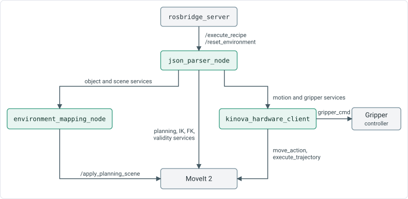
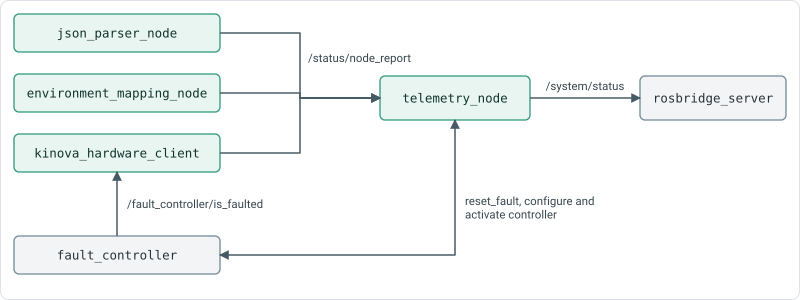

# Middleware nodes

The `kinova_interface` package provides four nodes. Message and service definitions are in [ROS interfaces](ros-interfaces.md).

## json_parser_node

Receives a recipe, runs its steps in order and reports the result.

**Services**

| Service | Type | Description |
|---|---|---|
| `/execute_recipe` | `ExecuteRecipe` | Runs a recipe passed as a JSON string. Returns when the whole recipe has finished. |
| `/reset_environment` | `std_srvs/Trigger` | Restores the objects and obstacles to the configured state and clears the held object. |

**Parameters**

| Parameter | Default | Description |
|---|---|---|
| `recipe` | `none` | Recipe file to run once at start-up, two seconds after the node starts. An absolute path, or a path relative to the installed `recipes` folder. `none` waits for the service. |
| `grasping.*` | see [Configuration](../installation/configuration.md) | Settings for pickup, dropoff and the planner. Read from `motion_settings.yaml`. |
| `hardware.action_timeout`, `hardware.gripper_timeout` | `30.0`, `10.0` | Used to size the timeouts of the calls it makes to `kinova_hardware_client`. |

**Behaviour**

- Runs one recipe at a time. A recipe needs a non-empty `steps` list. `recipe_name` is optional.
- Each step is `{"action": ..., "parameters": {...}}`. `description` is optional and is logged. Other keys, such as `step_id`, are ignored.
- Stops at the first step that fails and returns `Recipe failed at step N (action): reason`. An action name that is not one of the ten returns `Unknown action '<name>'`.
- Waits 0.5 s between steps.
- Keeps the name of the held object. `pickup` sets it. `dropoff` and `throw` clear it.
- Gives each action the steps that follow it, so `pickup` can choose a grasp that suits a later `pour` or `thrust`.
- Writes one `[recipe_log]` line per step to the node log, with the action, its parameters and the result.

## environment_mapping_node

Maintains objects, obstacles, named movements and orientation presets, synchronising objects and obstacles with MoveIt's planning scene.

**Services**

| Service | Type | Description |
|---|---|---|
| `/get_coordinates` | `GetObjectCoordinates` | Position of an object. |
| `/get_object_info` | `GetObjectInfo` | Pose and shape of an object. |
| `/get_relative_movement` | `GetRelativeMovement` | Offset of a named movement. |
| `/get_orientation_preset` | `GetOrientationPreset` | Roll, pitch and yaw of a named orientation. |
| `/get_robot_parameters` | `GetRobotParameters` | Object, movement and orientation names, table bounds and held objects. The proxy reads this before every command. `json_parser_node` reads the object names for `push`, `thrust` and `throw`. |
| `/get_scene_objects` | `GetSceneObjects` | All objects and the attached ones, as JSON. |
| `/update_scene_objects` | `UpdateSceneObjects` | Adds, updates or removes objects in bulk. The vision node uses it. |
| `/update_object_pose` | `UpdateObjectPose` | Changes the stored pose of an object. |
| `/attach_object` | `AttachObject` | Attaches an object to the gripper in the planning scene. |
| `/detach_object` | `DetachObject` | Detaches an object and leaves it in the scene. |
| `/remove_object` | `RemoveObject` | Deletes an object from the scene and the dictionary. The object must not be attached. |
| `/reset_environment_scene` | `std_srvs/Trigger` | Reloads the objects and obstacles from `workspace_objects.yaml` and republishes the scene. |

**Parameters**

| Parameter | Default | Description |
|---|---|---|
| `config_dir` | none | Folder that holds `workspace_objects.yaml` and `movements_and_orientations.yaml`. Required. The launch file sets it. |

**Behaviour**

- Reads both files once at start-up. A missing file, an invalid file or an object without a valid orientation stops the node.
- Accepts an orientation as `roll`, `pitch` and `yaw`, or as a quaternion `x`, `y`, `z`, `w`. It stores a quaternion.
- Supports `BOX`, `CYLINDER`, `CONE` and `SPHERE` shapes. An unknown shape type becomes a box with a warning. A wrong number of dimensions is replaced by default dimensions with a warning.
- Waits up to 15 s for `/apply_planning_scene`, waits one more second, then adds every obstacle and object to the planning scene.
- `/update_object_pose` changes the dictionary only. It does not move the object in the planning scene.
- `/update_scene_objects` skips attached objects. With `remove_missing` set, it removes only objects that were not loaded from the file, which are the objects added by vision.
- `/reset_environment_scene` removes any attachment and restores the file contents.

## kinova_hardware_client

The sole middleware node sending arm and gripper motion commands. Its services use the /kinova_hardware_client/ prefix.

**Services**

| Service | Type | Description |
|---|---|---|
| `/kinova_hardware_client/home_arm` | `HomeArm` | Moves to `hardware.home_joint_positions`. |
| `/kinova_hardware_client/move_arm` | `MoveArm` | Moves `tool_frame` to a position, with an optional orientation. |
| `/kinova_hardware_client/relative_move` | `RelativeMove` | Moves `tool_frame` by an offset from its current pose. |
| `/kinova_hardware_client/joint_move` | `JointMove` | Moves to joint positions, absolute or relative to the current joints. |
| `/kinova_hardware_client/execute_trajectory` | `ExecuteTrajectory` | Runs a trajectory that was planned elsewhere. |
| `/kinova_hardware_client/move_gripper` | `MoveGripper` | Moves the gripper to a position. |

**Parameters** (all required, from the `hardware` section of `motion_settings.yaml`)

| Parameter | Default | Description |
|---|---|---|
| `hardware.action_timeout` | `30.0` | Seconds an arm move may take before it counts as failed. |
| `hardware.gripper_timeout` | `10.0` | Seconds a gripper move may take. |
| `hardware.planning_time` | `10.0` | Planning time for each goal sent to MoveIt. |
| `hardware.goal_tolerance` | `0.01` | Radius, in metres, of the position goal. |
| `hardware.home_joint_positions` | `[0.0, 0.0, 1.5708, 1.5708, 1.5708, 0.0]` | Joint 1 to 6 for home. |
| `hardware.home_joint_tolerance` | `0.01` | Tolerance of each joint at home and for joint moves, in radians. |

**Behaviour**

- Each service returns when the motion has finished, failed or timed out. It reports `success` and a message.
- Arm moves go to MoveIt's `move_action`. The node tries Pilz PTP first. If MoveIt reports a failure before any motion (planning failed, no IK solution, invalid motion plan or invalid goal constraints), it tries OMPL RRT\*. A `move_arm` request without an orientation goes to RRT\* directly, because Pilz needs a full pose.
- A successful message ends with the planner used, for example `Movement complete (planned with Pilz PTP)`.
- Speed comes from `motion_params`. A value of `0.0` leaves the speed unset: Pilz runs at full speed and OMPL uses MoveIt's default scaling. Values outside 0 to 1 are clamped.
- The gripper goal succeeds when the gripper reaches the position or stalls on an object.
- `joint_move` with `wait_for_completion` false returns after at most 0.5 s. It reports a failure that happens in that time and otherwise reports that the goal was accepted.
- Subscribes to `/fault_controller/is_faulted`. While the robot is faulted the node reports the fault state. Every 3 s it checks that `fault_controller` is active and reports `SYSTEM CONFIG WARNING: fault_controller is NOT active` when it is not.

## telemetry_node

Collects the node heartbeats into one system status.

**Interfaces**

| Name | Type | Description |
|---|---|---|
| `/status/node_report` | `ExtendedStatus` (subscribed) | Heartbeat from each node. |
| `/system/status` | `SystemSummary` (published) | Aggregate status, every 0.5 s. |
| `/system/reset_fault` | `std_srvs/Trigger` | Forwards to the driver's `/fault_controller/reset_fault`. |

**Behaviour**

- The system state is `SYSTEM_FAULT` if any node reports `STATE_FAULT`, otherwise `SYSTEM_BUSY` if any node reports `STATE_BUSY`, otherwise `SYSTEM_READY`.
- Missing heartbeats for over 1.5 s trigger a fault with CRITICAL: Node heartbeat timed out. The system remains SYSTEM_FAULT until its first heartbeat.
- When `kinova_hardware_client` reports an inactive `fault_controller`, the node configures and activates it through the controller manager.
- `/system/reset_fault` waits 2 s for the driver service. If the service is missing it returns `Hardware driver service not ready.`
