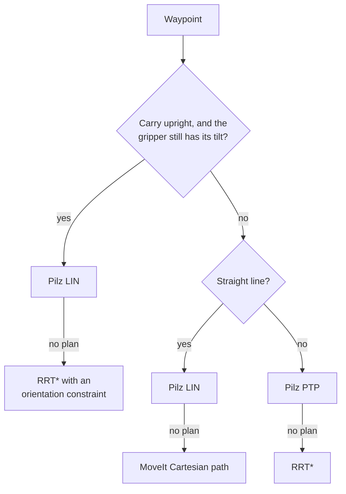

# Motion and actions

This page describes how the ten recipe actions plan and run motion. The parameters of each action are in the [Command reference](../../user-guide/command-reference.md).

## Action groups

| Group | Actions | How the motion is produced |
|---|---|---|
| Direct moves | `home`, `move_arm`, `relative_move`, `gripper` | One service call to `kinova_hardware_client`. MoveIt plans and runs the move. |
| Pick and place | `pickup`, `dropoff` | A chain of waypoints is planned with MoveIt services and checked as a whole. The plans then run as trajectories. See [Pickup and dropoff](pickup-and-dropoff.md). |
| Composite motions | `pour`, `push`, `thrust`, `throw` | Joint moves and relative moves in a fixed pattern. See [Pour](pour.md), [Push and thrust](push.md) and [Throw](throw.md). |

Every action returns `(success, message)` to `json_parser_node`. The action modules are in `kinova_interface/kinova_interface/actions/`.

## Planners

MoveIt 2 plans every motion. The middleware uses two planning pipelines.

| Pipeline | Planner | Used for |
|---|---|---|
| Pilz industrial motion planner | `PTP` | Point-to-point moves in joint space. The path is the same every time. |
| Pilz industrial motion planner | `LIN` | Straight lines in Cartesian space. |
| OMPL | `RRTstarkConfigDefault` (RRT\*) | Fallback for free-space moves. It can route around obstacles. |

Pilz answers in milliseconds but does not plan around obstacles. The middleware always tries Pilz first and uses a fallback when Pilz cannot plan.

### Direct moves

`kinova_hardware_client` sends each goal to MoveIt's `move_action`. It tries Pilz PTP, then OMPL RRT\*, as described in [Middleware nodes](../middleware-nodes.md). A `move_arm` goal without an orientation uses RRT\* only.

### Pick and place waypoints

`pickup` and `dropoff` plan each waypoint with the first planner below that applies, and fall back to the second.

| Planner | Settings |
|---|---|
| Pilz | Planning time 1.0 s, one attempt. |
| RRT\* | `grasping.fallback_planning_time` seconds, four parallel attempts. Tolerances `grasping.position_tolerance` and `grasping.orientation_tolerance`. |
| Cartesian path | Step `grasping.cartesian_step`. Largest joint change between points `grasping.max_joint_jump`. The line counts only if at least 99.9% of it is planned. The trajectory is slowed to `grasping.velocity_scale`. |
| Upright constraint | The gripper keeps its tilt within `grasping.upright_tolerance` radians and may turn freely about the vertical axis. It applies only while the gripper is within that tolerance of the tilt it had at pickup. |

All goals are poses, so the planner chooses the joint solution. For pick and place, the planning workspace is a cube of 2 m on each side centred on `base_link`.

### Waypoint chains

`pickup` and `dropoff` plan all of their waypoints before the arm moves. Each waypoint is planned from the joint state where the previous one ends. If any waypoint cannot be planned, the action tries the next candidate grasp or placement, and fails if none works.

The first plan runs as planned. Each later move is planned again from the position the arm actually reached. After the object is attached, the new plans include it in the collision check.

## Speed

A recipe step can set `speed`, a value from 0.0 to 1.0. It sets the velocity and acceleration scale together. Without `speed`:

- Direct moves, `pour`, `push` and the rotation and wind-up of `throw` leave the speed unset. Pilz then runs at full speed and OMPL uses MoveIt's default scaling.
- `pickup` and `dropoff` use `grasping.velocity_scale` and `grasping.acceleration_scale`.
- `thrust` and the `throw` fling use 1.0.

## Collisions

The planning scene contains the objects, the obstacles and the table from `workspace_objects.yaml`, and any objects added by vision. While the gripper holds an object, the object is attached to `tool_frame` and is part of every collision check.

Some actions turn off a collision check for the time they need it:

- `pickup` and `push` allow contact between the held object and whatever it rests on, such as the table, while the object is lifted or extended. The check is restored when the move ends.
- `push`, `thrust` and `throw` go straight through the other objects of the scene. For the part of the motion that goes through them, collision checking between the arm and every object is turned off, except for `table_fit`. `thrust` and `throw` also let the held object touch them. The check is restored afterwards, also when the action fails.

The line-up of `push`, the pull-back and the turn of `thrust`, and the rotation and the wind-up of `throw` avoid all objects. The table and the walls are obstacles, not objects, so they stay checked.

The planning scene has no physics. The objects that the arm goes through stay where they are. Only the pushed object changes its position, and the thrown object is removed. A real object in the path is hit.

## Failures

A failed step returns a message with the reason. When `pickup` or `dropoff` fails, the action sends the arm home. If the failure happens close to the object, the action first moves back: `pickup` opens the gripper and returns to the pre-grasp pose, and `dropoff` returns to the hover pose. If the arm cannot move back, it stays where it is and the message says so.
