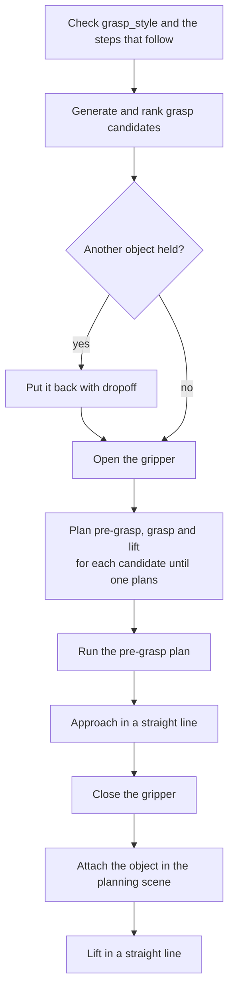
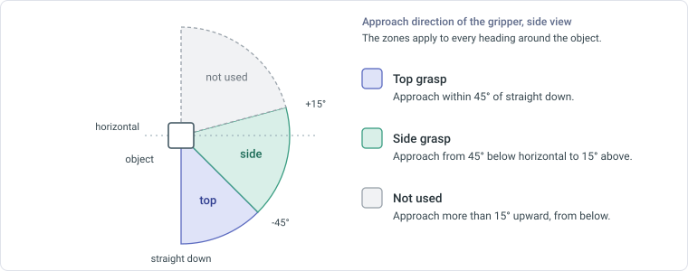
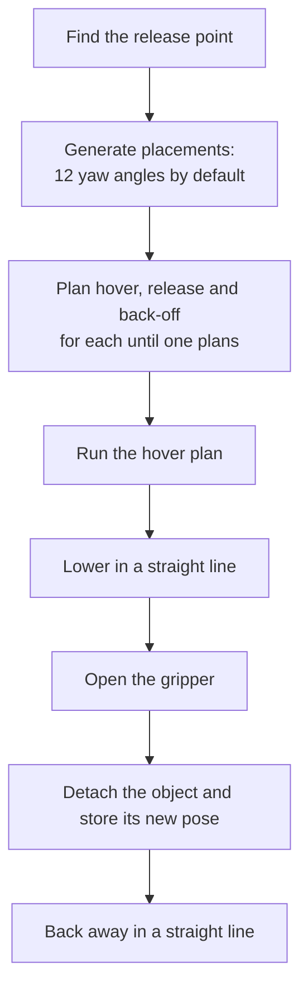

# Pickup and dropoff

`pickup` grasps an object and lifts it. `dropoff` puts the held object down. Both plan a chain of waypoints, check it as a whole and then run it. The code is in `actions/pickup.py`, `actions/dropoff.py`, `actions/motion.py` and `utils/grasping.py`. The settings are in the `grasping` section of `motion_settings.yaml`. See [Configuration](../../installation/configuration.md).

## Pickup

### Grasp styles

| Style | Description |
|---|---|
| `top` | The gripper comes down onto the object from above. |
| `side` | The gripper approaches level, or close to level. |
| `auto` | The default. Both styles are candidates. `side` ranks first for an object taller than `grasping.tall_ratio` times its narrowest horizontal width. Otherwise `top` ranks first. |

The action reads the steps that follow it, up to the next `dropoff`, `throw`, `pickup` or `gripper` step. A later `pour` needs a `side` grasp and keeps the object upright while it is carried. A later `thrust` needs a `side` grasp. With `grasp_style` set to `auto`, the action uses `side`. With `top` it fails and names the step, for example `Can't pick up 'water_bottle' with a top grasp: 'pour' (step 3) needs a side grasp`.

### Grasp candidates

The action lists every way to grasp the object, drops the unusable ones and ranks the rest.

1. **List.** For a box, each face is an approach direction, and the fingers close across either of the other two axes in either direction. For a cylinder, the approach is from either end or from the side, at angles `grasping.yaw_step_deg` apart around its axis. Other shapes cannot be grasped.
2. **Classify.** An approach within 45° of straight down is a top grasp. An approach from 45° below horizontal to 15° above it is a side grasp. Any other approach is dropped.
3. **Check the width.** The object must be at most 0.145 m minus `grasping.width_margin` wide across the closing axis, and at least `grasping.min_width`.
4. **Place the fingers.** A top grasp puts the finger pads `grasping.top_grasp_depth` below the top of the object. The pads are raised if needed so that the fingertips stay `grasping.tip_clearance` above its bottom. A side grasp puts the pads at the centre of the object.
5. **Set the approach.** The pre-grasp pose is `grasping.standoff` back from the grasp along the approach. The lift pose is `grasping.lift_height` above the grasp.
6. **Rank.** The preferred style comes first. Within a style, the grasp closest to the natural wrist pose comes first. That pose reaches straight out from the base with the fingers closing sideways.

### Execution

If another object is held, the action first puts it back where it was with `dropoff`. It then opens the gripper, so that the planned moves see open fingers.

The action tries the candidates in order. For each one it plans the pre-grasp, grasp and lift waypoints as a chain. The first candidate with a complete chain is used.

1. Run the pre-grasp plan.
2. Approach the grasp pose in a straight line.
3. Close the gripper.
4. Attach the object to the gripper in the planning scene.
5. Record the grasp. `dropoff` uses it to place the object with the same grasp.
6. Allow contact between the object and what it rests on, then lift in a straight line, then restore the check.

A failure returns a message that counts the candidates by style and reason, for example `No reachable grasp for 'tea_pot': side 16 tried (16 no path to pre-grasp (Pilz PTP: ...; RRT*: ...))`.

## Dropoff

### Release point

The release point is where the bottom centre of the object ends up.

| Parameters | Release point |
|---|---|
| `destination` | The centre of the top of the destination object. |
| none | The position the object had before it was picked up. |

With `direction` and `distance`, the point moves from there. `forward` moves away from the arm's base along the line from the base to the point, and `backward` moves toward it. `left` and `right` move sideways, 90° anticlockwise and clockwise as seen from above. With a destination, the moved point must still lie inside the outline of the destination.

### Placements

The action places the object with the grasp used at pickup. It tries the pickup yaw first, then turns the gripper about the vertical axis in steps of `grasping.yaw_step_deg`, alternating sides: 0°, +30°, -30°, +60° and so on up to 180°. That is 12 placements with the default step.

For each placement:

- The release pose puts the object `grasping.place_clearance` above the surface.
- The hover pose is `place_offset` above the release pose. `place_offset` comes from the step, or from `grasping.default_place_offset`, and may not exceed `grasping.max_place_offset`.
- The back-off pose is `grasping.standoff` back from the release pose along the approach.

If `pickup` kept the object upright for a later `pour`, the hover move keeps the tilt. See [Motion and actions](index.md).

### After the release

The action detaches the object, stores its new position and orientation in the object dictionary, clears the held object and backs away. Later steps use the new position.
