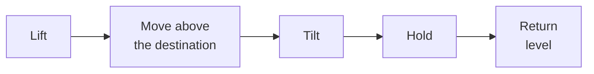

# Pour

`pour` lifts the held object, optionally carries it over a destination, tilts it, holds the tilt and returns the object to level. The code is in `actions/pour.py`.

## Requirements

- An object must be held. `target` defaults to the held object. A different name fails with `Cannot pour '<target>': held object is '<held>'`.
- The object must be level in the gripper. `pickup` grasps from the side when a `pour` follows it in the same recipe. See [Pickup and dropoff](pickup-and-dropoff.md). The action does not check the tilt of an object that an earlier recipe picked up.

## Sequence

| Step | Motion |
|---|---|
| Lift | A relative move up by `lift_height`, 0.14 m by default. The orientation does not change. |
| Move above the destination | A relative move over the destination. Skipped when the step has neither `destination` nor `direction`. |
| Tilt | A relative joint move that adds `tilt_angle` to joint 6. The default is 2.356 rad, which is 135°. |
| Hold | Waits `duration` seconds, 1.5 by default. |
| Return level | A relative joint move that subtracts `tilt_angle` from joint 6. |

The target point is the centre of `destination`, or the point `distance` away from the object's stored position in `direction`. `distance` defaults to 0.3 m. The relative move is the offset between the object's stored position and that point.

The tilt rotates joint 6 only. The position of the gripper does not change, and no Cartesian orientation target is computed.

The object stays in the gripper after the action. Place it with a later `dropoff` step. The success message names where it poured, for example `Poured 'water_bottle' toward 'delivery_tray'`, or `in place` when the step has neither `destination` nor `direction`.
