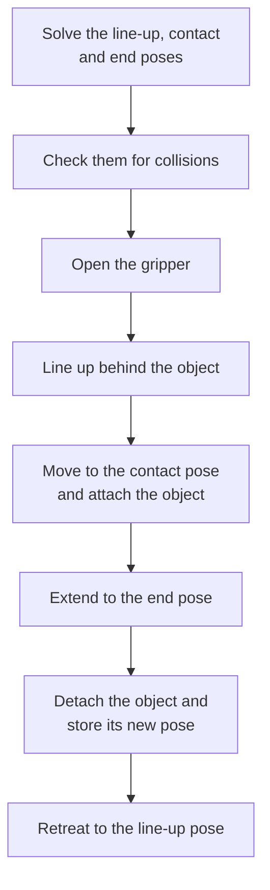
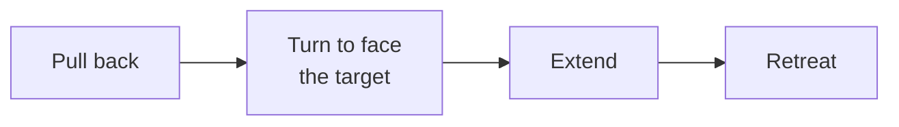

# Push and thrust

`push` slides an object across the table with the open gripper. `thrust` raises a held object, pulls it back and extends it toward a target. Both move in a single vertical plane and go straight through other objects. The code is in `actions/push.py`, `actions/thrust.py` and `ArmActions.solve_planar_reach` in `actions/arm_actions.py`.

## Planar reach

In both actions joint 1 turns the arm to face the target, and the wrist (joints 4, 5 and 6) stays at 0. Only joints 2 and 3 move, so the gripper moves in the vertical plane that contains the target. A position in that plane is a distance from the base and a height.

`solve_planar_reach` finds the joints 2 and 3 for a position. It uses a Newton-Raphson search over the two joints. Each step calls `/compute_fk` to get the distance and height of `tool_frame`. The search runs at most 15 iterations from a bent posture of joint 2 at -20° and joint 3 at 140°, or from the previous solution. A solution counts when the error is at most 0.01 m. The action then checks the joint state with `/check_state_validity` before the arm moves.

When an action has no `distance`, it searches for the largest reachable stroke between 0.05 m and 0.5 m by ten bisections, and subtracts a margin of 0.03 m. `push` searches in `direction` from the object. `thrust` searches along its bearing from the pull-back pose. The message `No reachable push distance found for '<target>' in direction '<direction>'` means the smallest distance is already out of reach. `thrust` reports `No reachable thrust distance found for '<target>'`.

## Push

`push` never grasps or lifts the object. The `target` must be an object that is not held. The action does not check this.

- The line-up pose is in the same plane as the contact pose, at the height of the object, on the base side of the object. Its distance from the centre of the object is half the size of the object along the line from the base plus `grasping.standoff`. The arm reaches it with normal collision checking, so it goes around the object.
- The contact pose puts `tool_frame` at the stored centre of the object. The end pose is at the same height at the target point. The target point is the centre of `destination`, or the point `distance` away from the object in `direction`.
- `direction` is relative to the line from the base to the object. `forward` moves the object away from the base and `backward` toward it. `left` and `right` are 90° from that line. The motion extends the arm, so it pushes objects away from the base. It is not designed to pull an object back toward the base.
- The gripper opens before the line-up and stays open. Nothing grips the object, and a `close_position` in the step has no effect.
- The object is attached at the contact pose in the planning scene only, so that the scene follows it. After the extend, the object is detached and its stored position becomes the end point at the original height.
- The move in to the contact pose, the extend and the retreat go straight through the other objects of the scene. See [Collisions](index.md#collisions).
- The object is pushed from its centre. A large object can be pushed from a point where a person would not hold it.

A line-up pose that cannot be solved fails the step with `Could not solve a pose to line up behind '<target>' for push`. A line-up pose in collision fails it with `Push line-up pose behind '<target>' is in collision`.

## Thrust

`thrust` needs a held object that is level in the gripper. `pickup` grasps from the side when a `thrust` follows it. See [Pickup and dropoff](pickup-and-dropoff.md).

| Step | Motion |
|---|---|
| Pull back | A joint move to the level pose where `tool_frame` is `lift_height` above the object's stored height, 0.14 m by default, and 0.30 m from the base on the line from the base to the object. If that pose is blocked, the distance from the base grows in steps of 0.05 m up to the distance of the object. Joint 1 faces the object. |
| Turn | Joint 1 turns to face the target. Joints 2 and 3 do not move. The pose is checked for collisions first. |
| Extend | Joints 2 and 3 extend along that bearing at the raised height, to the reach limit. |
| Retreat | The arm returns to the pose after the turn. |

The bearing is the direction from the base to `destination`, or the direction from the base to the object turned by `direction`. `forward` keeps it, `left` and `right` turn it by 90° and `backward` points to the far side of the base. The arm does not stop at `destination`. The pull-back makes the stroke long even when `destination` is no further from the base than the object.

With `direction` and `distance`, the end point is the point `distance` away from the original position of the object in `direction`, and the bearing points to it.

The pull-back and the turn avoid all objects. The reach search, the extend and the retreat go straight through the other objects, and the held object may touch them. See [Collisions](index.md#collisions).

`thrust` runs at speed 1.0 unless the step sets `speed`. The object stays in the gripper after the action.
