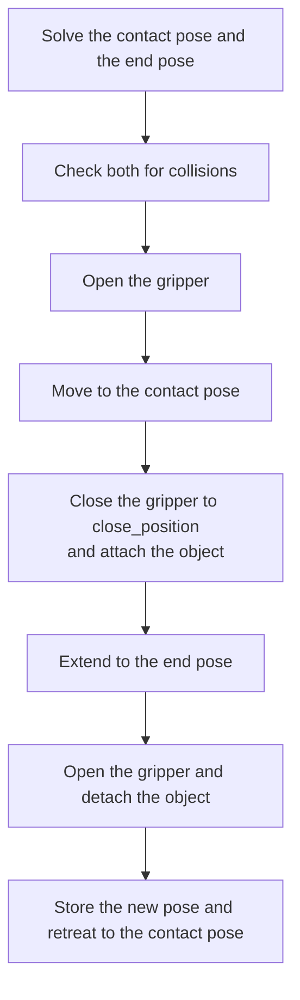
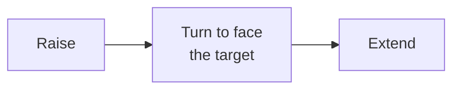

# Push and thrust

`push` slides an object across the table by keeping the gripper in contact with it. `thrust` raises a held object and extends it toward a target. Both move in a single vertical plane. The code is in `actions/push.py`, `actions/thrust.py` and `ArmActions.solve_planar_reach` in `actions/arm_actions.py`.

## Planar reach

In both actions joint 1 turns the arm to face the target, and the wrist (joints 4, 5 and 6) stays at 0. Only joints 2 and 3 move, so the gripper moves in the vertical plane that contains the target. A position in that plane is a distance from the base and a height.

`solve_planar_reach` finds the joints 2 and 3 for a position. It uses a Newton-Raphson search over the two joints. Each step calls `/compute_fk` to get the distance and height of `tool_frame`. The search runs at most 15 iterations from a bent posture of joint 2 at -20° and joint 3 at 140°, or from the previous solution. A solution counts when the error is at most 0.01 m. The action then checks the joint state with `/check_state_validity` before the arm moves.

When a step has `direction` without `distance`, the action searches for the largest reachable distance between 0.05 m and 0.5 m by ten bisections, and subtracts a margin of 0.03 m. The message `No reachable push distance found for '<target>' in direction '<direction>'` means the smallest distance is already out of reach.

## Push

`push` never grasps or lifts the object. The `target` must be an object that is not held. The action does not check this.

- The contact pose puts `tool_frame` at the stored centre of the object. The end pose is at the same height at the target point. The target point is the centre of `destination`, or the point `distance` away from the object in `direction`.
- `direction` is relative to the line from the base to the object. `forward` moves the object away from the base and `backward` toward it. `left` and `right` are 90° from that line. The motion extends the arm, so it pushes objects away from the base. It is not designed to pull an object back toward the base.
- The gripper closes to `close_position`, 0.75 by default, so that the fingers form a flat pushing surface.
- The object is attached while it moves, so the planning scene follows it. After the extend, the object is detached and its stored position becomes the end point at the original height.
- The pushed object is exempt from collision checking for the whole action. The exemption is removed at the end, including when the action fails.
- The object is pushed from its centre. A large object can be pushed from a point where a person would not hold it.

## Thrust

`thrust` needs a held object that is level in the gripper. `pickup` grasps from the side when a `thrust` follows it. See [Pickup and dropoff](pickup-and-dropoff.md).

| Step | Motion |
|---|---|
| Raise | A joint move to the pose where `tool_frame` is `lift_height` above the object's stored height, 0.14 m by default. Joint 1 faces the stored position of the object, and the wrist is level. |
| Turn | Joint 1 turns to face the target. Joints 2 and 3 do not move. |
| Extend | Joints 2 and 3 extend to the target at the raised height. |

The target is the centre of `destination`, or the point `distance` away in `direction`. `direction` is measured from the original position of the object, before it was picked up. Without `distance` the action searches for the largest reachable distance, as for `push`.

`thrust` runs at speed 1.0 unless the step sets `speed`. The object stays in the gripper after the action.
