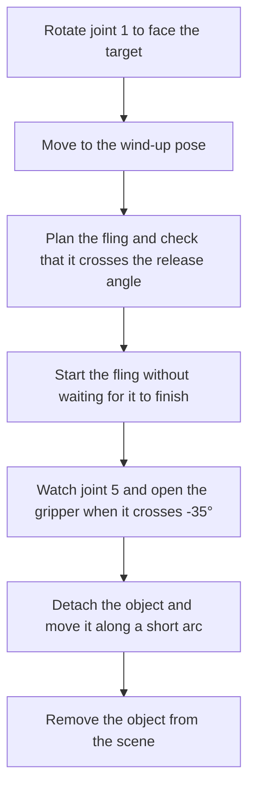

# Throw

`throw` swings the held object and opens the gripper partway through one continuous motion. The code is in `actions/throw.py`.

## Requirements

- An object must be held. `target` defaults to the held object.
- The step needs `destination` or `direction`. They set only the direction the arm faces. The swing has a fixed shape and does not scale with distance.

## Sequence

1. **Rotate.** Joint 1 turns to `atan2(y, x)` of the target point. The other joints stay where `pickup` left them.
2. **Wind up.** The arm moves to the wind-up pose.
3. **Plan the fling.** The fling is planned before it starts, with Pilz PTP and then RRT\* as fallback. The action fails if the planned motion never crosses the release angle.
4. **Fling.** The fling runs as one motion to the end pose. The action does not wait for it to finish.
5. **Release.** The action reads the live position of joint 5. When it crosses -35.0°, the gripper opens to `open_position`, 0.0 by default. If joint 5 does not cross within the planned duration plus 3 s, the step fails with `Timed out waiting for the release point`.
6. **Landing.** The object is detached and its stored position moves along a short arc to the target point at its original height. The arc takes 0.6 s in 8 steps and rises to 15% of the horizontal distance. This is a visual aid. Physics is not simulated.
7. **Removal.** The object is removed from the planning scene and the object dictionary, so that it does not block later moves. `/reset_environment` restores it.

## Poses

The joint values are fixed. Only joint 1 changes between throws.

| Joint | Wind-up | End of fling |
|---|---|---|
| 1 | `atan2(y, x)` of the target | same |
| 2 | -22.84° | 32.63° |
| 3 | 56.01° | -34.26° |
| 4 | 80.71° | 80.71° |
| 5 | 50.6° | -63.25° |
| 6 | 0.0° | 0.0° |

Joint 5 swings from 50.6° to -63.25°. The release angle of -35.0° is about three quarters of the way through that swing.

## Speed

`speed` scales the rotation and the wind-up. The fling runs at 1.0 unless `speed` is set.
