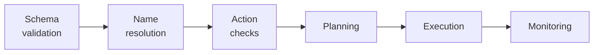
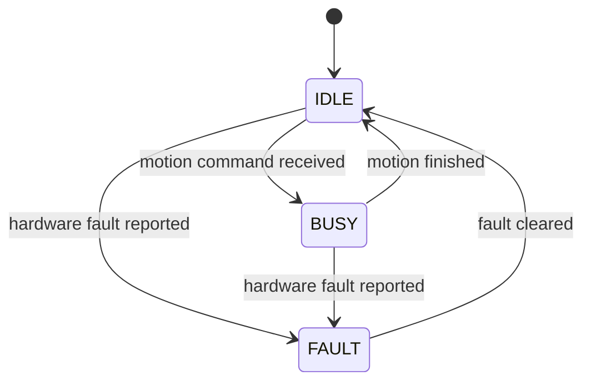

# Safety and contracts

Describes motion validation, fault handling and known safety limitations.

!!! warning
    Run a new recipe in simulation before running it on the arm. The checks below prevent known classes of error. They do not make an arbitrary instruction safe.

## Execution contract

- Recipes contain a non-empty `steps` list with supported actions: `home`, `move_arm`, `relative_move`, `gripper`, `pickup`, `dropoff`, `pour`, `push`, `thrust`, `throw`.
- Steps execute sequentially. The first failure stops execution; only one recipe runs at a time.
- Failed `pickup` or `dropoff` actions attempt to retreat and return home if motion has begun. Other actions stop in place.
- `/execute_recipe` returns `success` and `message`, identifying the failed step, action and reason.

## Validation layers

A command passes through the layers below in order. A failure at any layer stops the command at that layer.



| Layer | Where | Behaviour on failure |
|---|---|---|
| Schema | Proxy (`json_schema.json`) | Rejects invalid recipes before execution. |
| Name resolution | Proxy backend | Rejects unknown or ambiguous objects; retries eligible missing-object refusals once. |
| Action checks | Parser and action modules | Rejects invalid parameters, held-object states and incompatible grasp styles. |
| Planning | MoveIt 2 | Rejects unreachable or collision-blocked trajectories. |
| Execution | Controllers / Kortex driver | Stops on trajectory failure or hardware protection. |
| Monitoring | Middleware | Reports timeouts and hardware faults (`SYSTEM_FAULT`). |

The planning scene contains the objects, the obstacles, the table and the object held by the gripper. The held object is checked in every plan.

## Fault handling

`kinova_hardware_client` reports one of three states.


`telemetry_node` publishes `/system/status`:

- `SYSTEM_FAULT`: Node fault, missing heartbeat (>1.5 s), or no initial heartbeat.
- `SYSTEM_BUSY`: At least one node is busy.
- `SYSTEM_READY`: All nodes are healthy and idle.

To clear a hardware fault, call the reset service:

```bash
ros2 service call /system/reset_fault std_srvs/srv/Trigger {}
```

On hardware, `telemetry_node` automatically configures and activates `fault_controller` if driver startup leaves it unconfigured.

## What is not checked

- **Intent:** Neither the proxy nor middleware independently evaluates command safety. The model may produce `safety_violation`, but this is not enforced by a separate safety checker.
- **Bridge access:** `rosbridge_server` has no authentication or service restrictions. Any reachable client can invoke ROS services or publish topics. Restrict access using the host firewall.
- **Direct recipes:** `json_parser_node` does not enforce the proxy schema. Invalid steps can fail after earlier movements have executed.
- **Unmodelled objects:** Collision avoidance only considers the planning scene. Object locations are not independently verified.
- **Speed and collisions:** `thrust` and the `throw` fling default to full speed. `push` temporarily disables collision checking for the pushed object.
