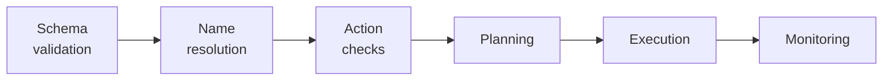
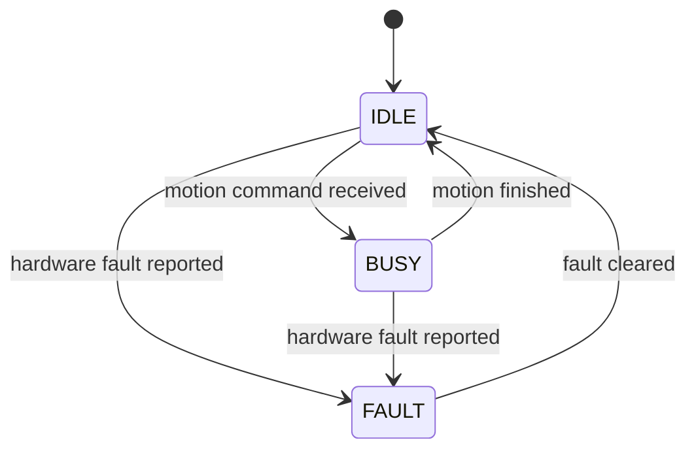

# Safety and contracts

This page describes what the system checks before and during motion, what happens when a check fails, and what is not checked.

!!! warning
    Run a new recipe in simulation before running it on the arm. The checks below prevent known classes of error. They do not make an arbitrary instruction safe.

## Execution contract

- A recipe is a JSON object with a non-empty `steps` list.
- Each step names one of ten actions: `home`, `move_arm`, `relative_move`, `gripper`, `pickup`, `dropoff`, `pour`, `push`, `thrust`, `throw`. Any other name fails the step.
- Steps run in order, one at a time. The first failed step stops the recipe. Later steps do not run.
- When `pickup` or `dropoff` fails after the arm has started to move, the action tries to back away from the object and return the arm home. A failure before any motion, such as an unresolved name, only returns the message. The other actions leave the arm where it stopped.
- `/execute_recipe` returns `success` and a `message`. On failure the message names the step, the action and the reason, for example `Recipe failed at step 2 (pickup): Could not resolve pickup target 'red_cube'`.
- Only one recipe runs at a time.

## Validation layers

A command passes through the layers below in order. A failure at any layer stops the command at that layer.



| Layer | Where | Behaviour on failure |
|---|---|---|
| Schema validation | Proxy backend, `json_schema.json` | The recipe is rejected and the error is shown in the terminal UI. Nothing is sent to the arm. |
| Name resolution | Proxy backend | A name that is unknown or matches several objects produces an error document (`missing_object` or `invalid_command`). A missing-object refusal from the model is retried once when exactly one object matches. |
| Action checks | `json_parser_node` and the action modules | The step fails with a message. An action that needs a held object fails when nothing is held or the named object is not held. `pickup` fails when its grasp style conflicts with a later `pour` or `thrust`. |
| Planning | MoveIt 2 | The step fails with the planner's reason, such as `planning failed (path blocked by an obstacle or self-collision)` or `out of reach (no IK solution)`. |
| Execution | Controllers and driver | A failed trajectory fails the step. The arm's own limits and protective stops belong to the Kortex driver and the arm controller. |
| Monitoring | Middleware nodes | Moves that run past `hardware.action_timeout` or `hardware.gripper_timeout` fail. A fault is shown as `SYSTEM_FAULT`. |

The planning scene contains the objects, the obstacles, the table and the object held by the gripper. The held object is checked in every plan.

## Fault handling

`kinova_hardware_client` reports one of three states.



`telemetry_node` combines the node states into `/system/status`. The system is `SYSTEM_FAULT` when any node is faulted or has not sent a heartbeat for 1.5 s, `SYSTEM_BUSY` when any node is busy, and `SYSTEM_READY` otherwise. The system is also `SYSTEM_FAULT` until the first heartbeat arrives.

To clear a hardware fault, call the reset service:

```bash
ros2 service call /system/reset_fault std_srvs/srv/Trigger {}
```

On real hardware the Kortex driver can take several seconds to connect, and `fault_controller` can remain unconfigured. `telemetry_node` detects this and configures and activates the controller.

## What is not checked

- **Intent.** A recipe that passes every layer is executed, whatever the instruction meant. The schema allows the error type `safety_violation`, but only the language model can produce it. No component of the proxy or the middleware evaluates safety.
- **Access to the bridge.** `rosbridge_server` has no authentication and does not restrict services. Any client that can reach its port can call any service, including `/execute_recipe` and `/kinova_hardware_client/joint_move`, and can publish topics. Restrict access with the host firewall.
- **Recipes sent directly.** `json_parser_node` does not validate recipes against the schema. A step with a missing required parameter fails when it runs, after the earlier steps have moved the arm.
- **Unmodelled objects.** Collision checking covers only what is in the planning scene. The arm does not confirm that an object is where the dictionary or the camera says it is.
- **Speed.** `thrust` and the `throw` fling run at full speed by default. `push` turns off collision checking for the pushed object while the action runs.
